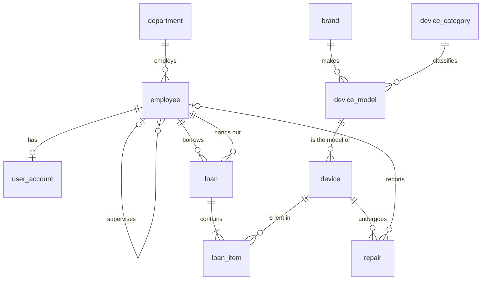

# Equipment loans dataset

Brevia SA is a services company of about 130 people. Its IT team lends laptops, screens,
phones and accessories to the employees. Until 2021 it tracked them in a spreadsheet; this
dataset is the database that replaced it, filled with the loans from January 2021 to the
**reference date, 30 September 2026** (use it instead of `current_date` in queries).

The schema is **one valid model** of this business, not the only one. Compare it with your
own model: where they differ, find the business rule that justifies each choice.

## Load

From the repository root, with the containers started (`docker compose up -d`):

```shell
# From inside the database container, no local psql needed
docker compose exec db psql -U postgres -d training_db -f /datasets/equipment-loans/load.sql
# Or with psql on your machine
psql -h localhost -U postgres -d training_db -f datasets/equipment-loans/load.sql
```

Loading drops and recreates the `equipment_loans` schema: your own tables in other schemas
are not touched. Query it with `set search_path to equipment_loans;` or prefix the tables
(`equipment_loans.device`).

## Business rules

- Every employee belongs to one department. An employee reports to at most one supervisor,
  who is an employee too; an apprentice reports to their trainer.
- An employee who leaves keeps their row: `left_on` records the date. Their history stays.
- An employee may have one user account. Warehouse clerks and delivery drivers have none.
- A device has an inventory tag stuck on it by the IT team and a serial number from the
  manufacturer; both are unique. A device is of one model, a model of one brand and one
  category.
- A device is in service, in repair or retired. Whether it is on loan is not stored on the
  device: a device is on loan when a loan item for it has not been returned.
- A loan is made by an IT team member (`handed_out_by_id`) to a borrower, on a date. It can
  hand out several devices. A long-term assignment, such as a work laptop, has no due date;
  a short loan, such as a projector for a presentation, has one.
- Each device of a loan is returned on its own date, with its condition. A device can only
  be out on one loan at a time.
- A repair concerns one device. Its cost is known once it is invoiced: a closed repair
  without a cost was never billed.

## Tables



| Table | Rows | Content |
| --- | --- | --- |
| `department` | 8 | Departments of the company |
| `employee` | 184 | Current and former employees, with their supervisor |
| `user_account` | 164 | Accounts of the employees who have one |
| `brand`, `device_category`, `device_model` | 10, 9, 29 | The catalogue of devices |
| `device` | 710 | Every device bought since the stock was inventoried |
| `loan`, `loan_item` | 1761, 2652 | Loans and the devices each one handed out |
| `repair` | 176 | Repairs, open and closed |

## Regenerate

`data.sql` is generated; do not edit it by hand. The generator is deterministic and needs
only Python 3:

```shell
python3 datasets/equipment-loans/generate.py > datasets/equipment-loans/data.sql
```
